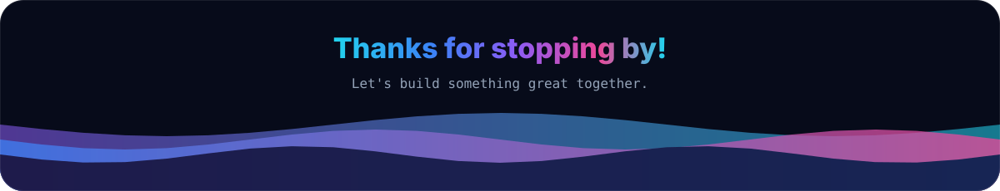

<!-- ================= HEADER ================= -->

  

  
  

<!-- ================= ABOUT ================= -->

<!-- ================= FOCUS ================= -->

<!-- ================= STACK ================= -->

   
  

  
  
  
  
  
  

<!-- ================= STATS ================= -->

<!-- Generated by .github/workflows/profile-assets.yml — no third-party stats services -->

<!-- Snake animation — generated by the same workflow -->

  <picture>
    <source media="(prefers-color-scheme: dark)" srcset="https://raw.githubusercontent.com/md-mehedi-hasan-nabil/md-mehedi-hasan-nabil/output/github-snake-dark.svg" />
    <source media="(prefers-color-scheme: light)" srcset="https://raw.githubusercontent.com/md-mehedi-hasan-nabil/md-mehedi-hasan-nabil/output/github-snake.svg" />
    
  </picture>

<!-- ================= CONNECT ================= -->

  
  
  
  

<!-- ================= FOOTER ================= -->

